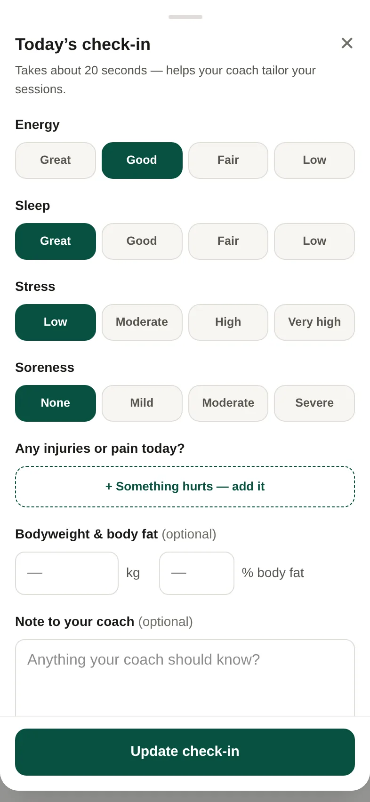

1. On the **Programme** tab, open today's check-in.
2. Pick an answer for energy, sleep, stress and soreness.
3. If something hurts, tap **+ Something hurts — add it**. Say where it is and which side, and give it a score from 0 to 10.
4. Add a **Note to your coach** if you like.
5. Tap **Save check-in**.

It takes about 20 seconds.

## Good to know

- Pick the closest answer. There are no wrong ones.
- **Usual** marks your most common answer from the last two weeks.
- Your coach sees your check-in next to your sessions.
- For an injury you've already added, give it a score each day, or tap **It's gone** when it's better.
- Missed yesterday? You can still answer for how you felt then.
- If you're worried about pain or an injury, speak to a doctor or physio.
