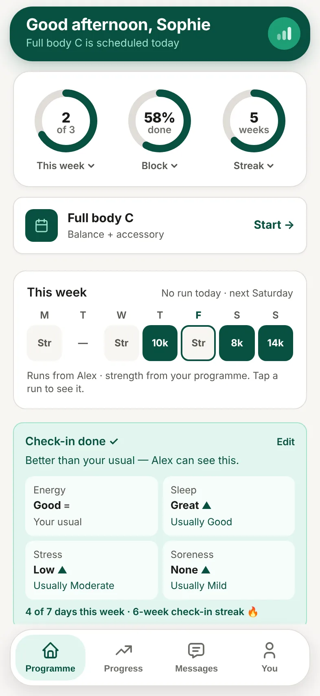

The tabs at the bottom of the app take you everywhere.

| Tab | What's there |
| --- | --- |
| **Programme** | Your home screen: today's session, your week and your daily check-in. |
| **Progress** | Your strength, training load, records and more. |
| **Messages** | Your conversation with your coach. |
| **You** | Your details, connected apps, notifications and your data. |

## On your home screen

- **Rings** at the top show this week, your block and your streak. You can choose which rings to show in **You**.
- **Today's session** has a **Start** button.
- **This week** shows each day at a glance.
- Your **check-in** card shows today's answers once you've checked in.
