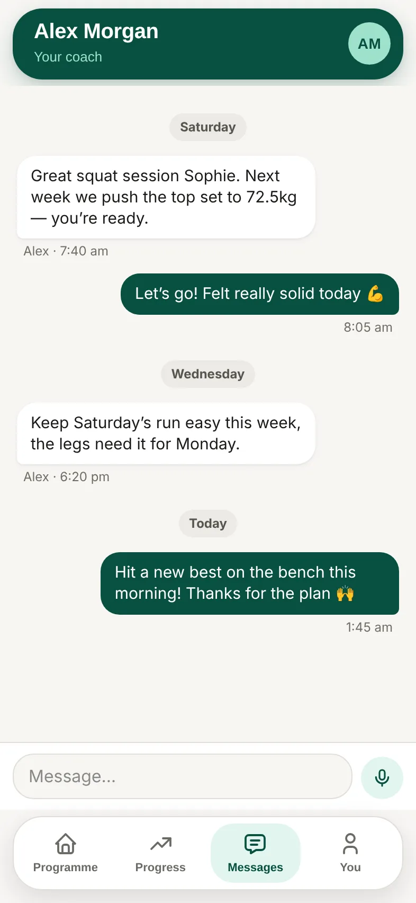

1. Go to **Messages**.
2. Type your message and send it.

## Good to know

- To mention something about an exercise, you can also tap **Note** on it during your session.
- If your coach is away, you'll see a short note with their dates. Your messages still reach them.
- To get an email when your coach replies, turn on **Email me about new messages** in **You**.
