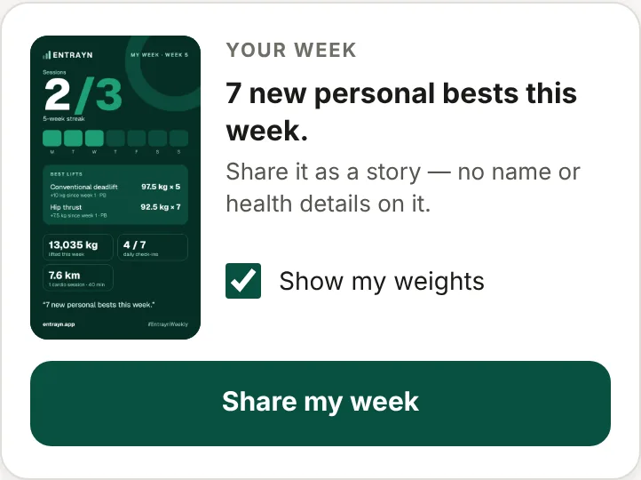

1. Go to **Progress**.
2. Find **Your week** and tap **Share my week**.
3. Choose where to share it.

If your phone can't share it directly, the picture is saved so you can post it from your photos or downloads.

## What's on it

Sessions done, days trained, best lifts and personal bests. It never shows your name, photo or health details.

To leave your weights off, untick **Show my weights** before you share.
