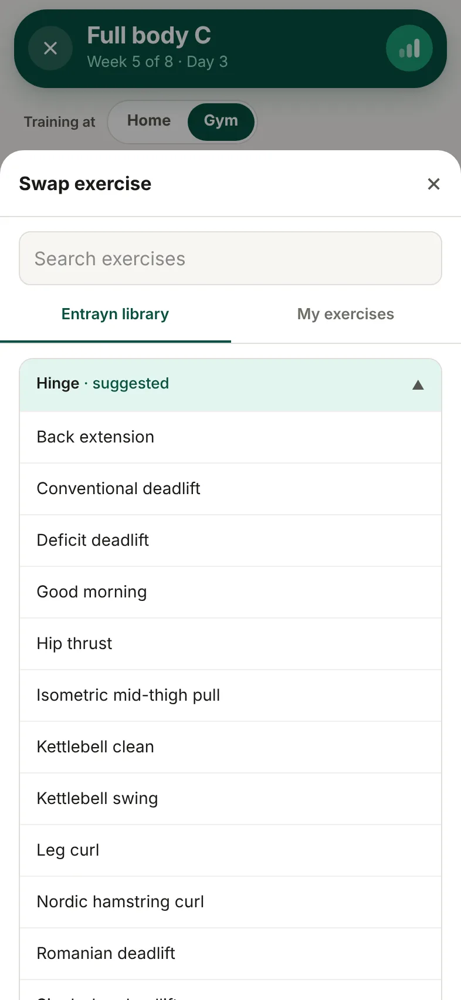

1. In your session, tap **Swap** on the exercise.
2. Search, or browse the **Entrayn library** or **My exercises**. Suggested swaps are listed first.
3. Pick the exercise you'd like instead.

The exercise shows **Swapped** with the name of the original.

## Good to know

- A swap lasts for this session only.
- Your coach can see what you swapped.
- Swapped sets don't count towards your personal bests.
- If your coach has locked your programme, you won't be able to swap.
