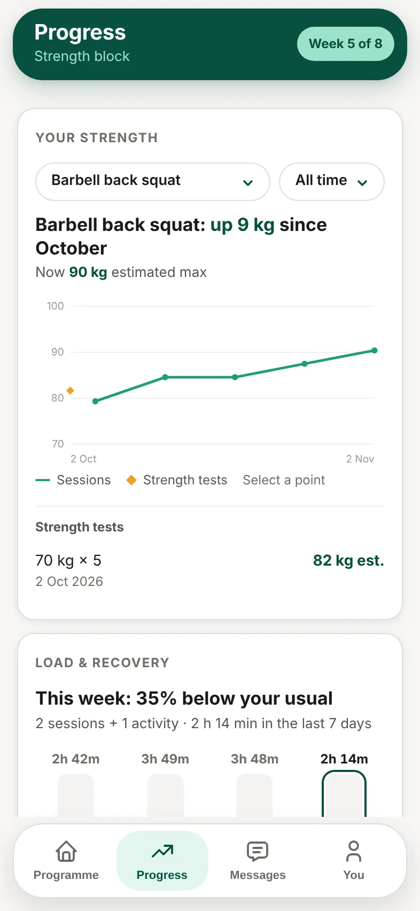

The **Progress** tab fills in as you log sessions and check in.

| Section | What it shows |
| --- | --- |
| **Your strength** | One lift at a time and how it's changed. Pick the lift and the time span. |
| **Load & recovery** | How much you've trained this week compared with your usual, and how you've felt. |
| **Personal bests** | Your best lifts. |
| **Body** | Bodyweight and body fat, if you record them. |
| **Badges** | Milestones you've reached. |
| **Your week** | A card you can share. See [How do I share my week?](/help/athletes/how-do-i-share-my-week) |

## Good to know

- The more you log, the clearer your trends get.
- Some sections only show once there's enough data.
