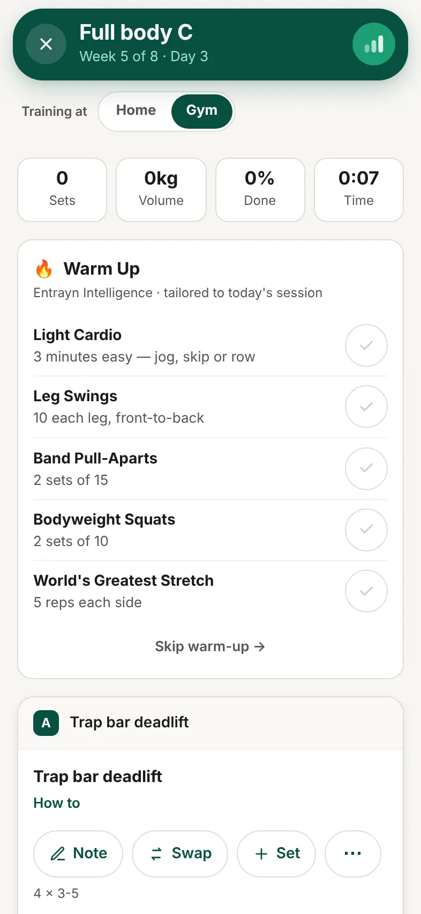

1. Open your session. The **Warm Up** is at the top.
2. Tick each item as you do it, or tap **Skip warm-up →**.
3. Do your main sets.
4. Scroll to the bottom for your cool-down, and tick items off the same way.

## Good to know

- They're made to suit that day's session.
