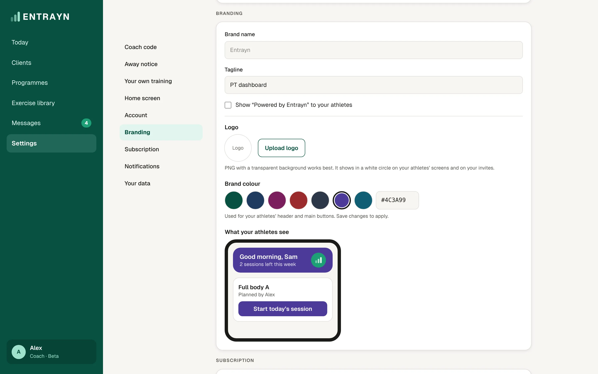

1. Go to **Settings**, then **Branding**.
2. Add your **Brand name** and **Tagline**.
3. Tap **Upload logo**. Zoom and move it to fit the circle, or choose **Show the whole logo**.
4. Pick a **Brand colour**, or type your own colour code.
5. Check **What your athletes see**, then save your changes.

## Good to know

- Your logo shows in a white circle in your athletes' app, on the join page and in invite emails.
- Your colour is used for your athletes' header and main buttons. If a colour is too light to read, Entrayn green is used instead.
- You can hide "Powered by Entrayn" or keep it showing.
- On the Base plan, you can set a brand name and tagline. Logo and colour come with Pro plans.
- The app name, icon, sign-in screen and email sender always stay Entrayn.
