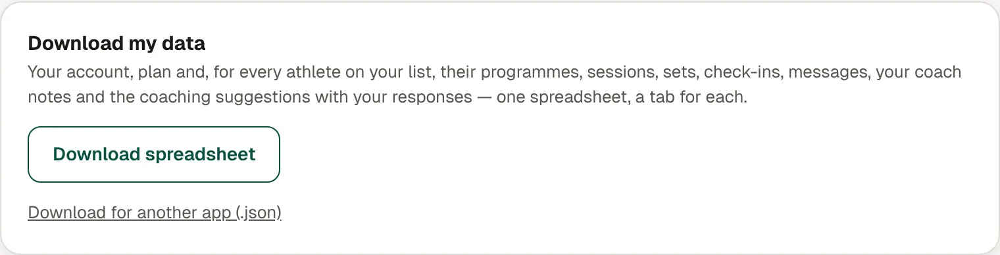

1. Go to **Settings**, then **Your data**.
2. Under **Download my data**, tap **Download spreadsheet**.

## What's in it

One spreadsheet with a tab for each kind of data:

- your account and plan
- for every client on your list: programmes, sessions, sets, check-ins and messages
- your coach notes, and the coaching suggestions with your responses

## Good to know

- **Download for another app (.json)** gives the same data in a format other apps can read.
- It works even if your plan is paused.
- It only includes clients you currently coach.
