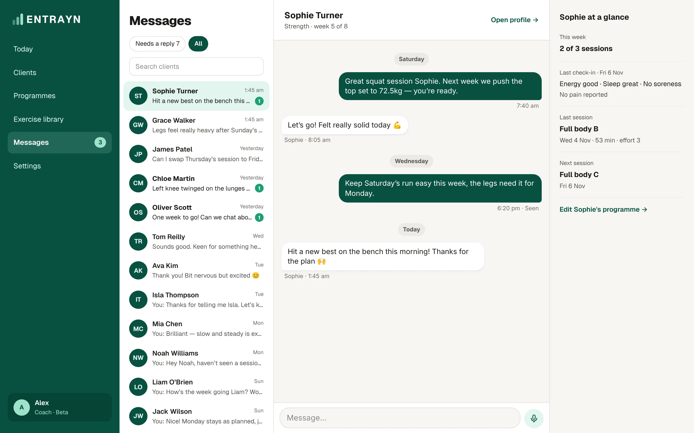

1. Go to **Messages**.
2. **Needs a reply** shows conversations waiting on you.
3. Tap a client to open the conversation, then type your message.

You can also open a client and tap **Message**.

## Good to know

- On a computer, the conversation stays open beside the client's page while you work.
- Clients get a notification for new messages, if they've turned them on.
