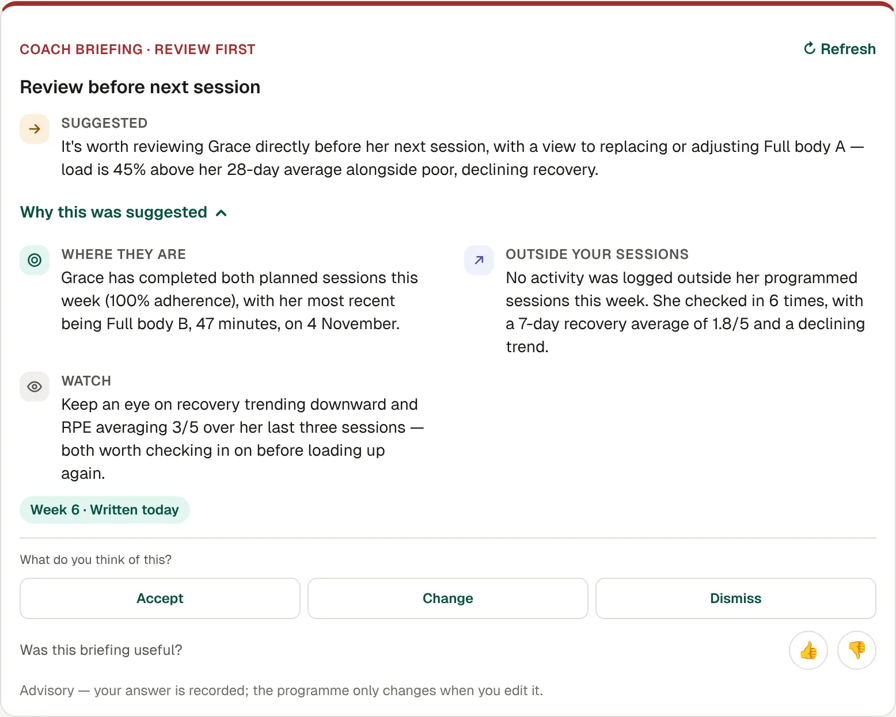

The coach briefing is on your client's **Overview**. It's part of the Pro plans.

1. Open your client. If there's no briefing yet, tap **Generate**.
2. Read the headline and the **Suggested** step first.
3. Tap **Why this was suggested** to see where they are, what they did outside your sessions, and what to watch.
4. If there's a suggestion, choose **Accept**, **Change** or **Dismiss**.
5. Tap 👍 or 👎 to tell us if it was useful.

## Good to know

- Your answer is recorded, but the programme only changes when you edit it.
- If there isn't enough data yet, the briefing says so rather than guessing.
- Tap **Refresh** after new sessions or check-ins come in.
