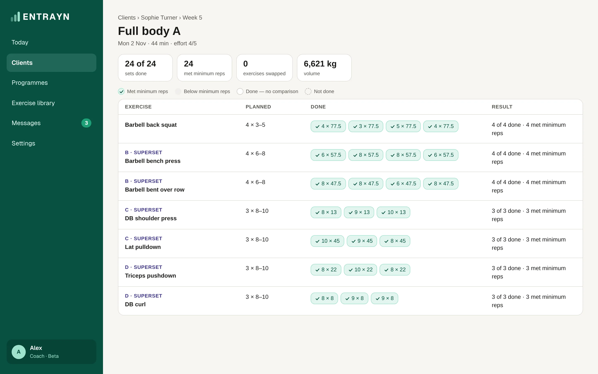

1. Open your client. On **Overview**, under **This week**, tap a finished session.
2. Or go to **Programme**, tap **See full week**, then **Review session →** on a finished session.

## Reading it

- **Planned** shows the sets and reps you set. **Done** shows what your client logged.
- **Met minimum reps** means they reached at least the lower number you planned.
- **Not in the saved plan** marks an exercise they added or swapped in.

## Good to know

- It works on a computer and a phone.
- It shows what happened. It doesn't score the session.
