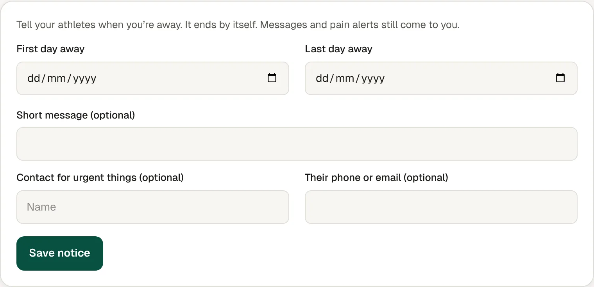

1. Go to **Settings**, then **Away notice**.
2. Pick your **First day away** and **Last day away**.
3. Add a **Short message** if you like.
4. Add a **Contact for urgent things** if you like.
5. Check **What athletes will see**, then tap **Save notice**.

## Good to know

- Your clients see one line on their home screen and in messages, in your brand.
- It ends by itself. To stop it sooner, tap **End now**.
- Messages and pain alerts still come to you while you're away.
- The person you list doesn't get access to your clients. Check they're happy to be listed.
