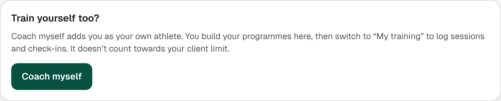

1. Go to **Settings**, then **Your own training**.
2. Tap **Coach myself**.
3. Build your programme the same way you would for a client.
4. Switch to **My training** to log your sessions and check-ins.

## Good to know

- You don't count towards your client limit.
- On a computer, **My training →** is in the sidebar.
- To stop, tap **Stop coaching myself**. Nothing is deleted.
