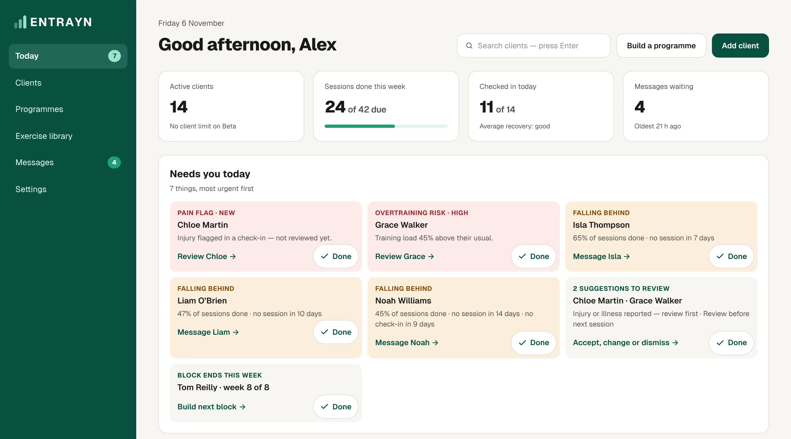
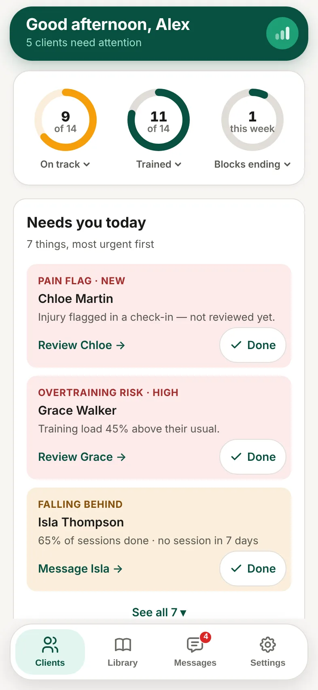

**Today** is your home screen. **Needs you today** lists what needs your attention, most urgent first.

1. Read each card's label, such as **Pain flag**, **Falling behind** or **Block ends this week**.
2. Use the card's link to act on it, for example **Review Chloe** or **Message Liam**.
3. Tap **Done** when you've dealt with it.

Below that, **New check-ins** shows who has checked in. Tap **Seen** to let them know you've looked.

## Good to know

- The cards are there to help you decide. What you do next is up to you.
- To see items you've ticked off, tap **Bring back**.
- On a phone, the top of the screen shows your rings and the first few cards. Tap **See all** for the rest.

