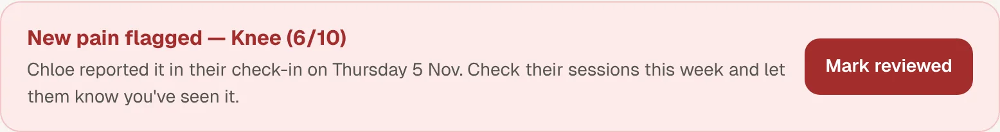

When a client reports pain or an injury in their check-in, Entrayn emails you and adds a **Pain flag** to **Needs you today**.

1. Open the client. A red box shows the area, the score and when they reported it.
2. Look at their sessions this week, and message them to say you've seen it.
3. Change their programme if you think it's needed.
4. Tap **Mark reviewed**. On a phone, opening their **Progress** tab marks it reviewed.

## Good to know

- Entrayn doesn't diagnose injuries or decide what to do. That's your call.
- If it sounds serious, suggest your client sees a health professional.
